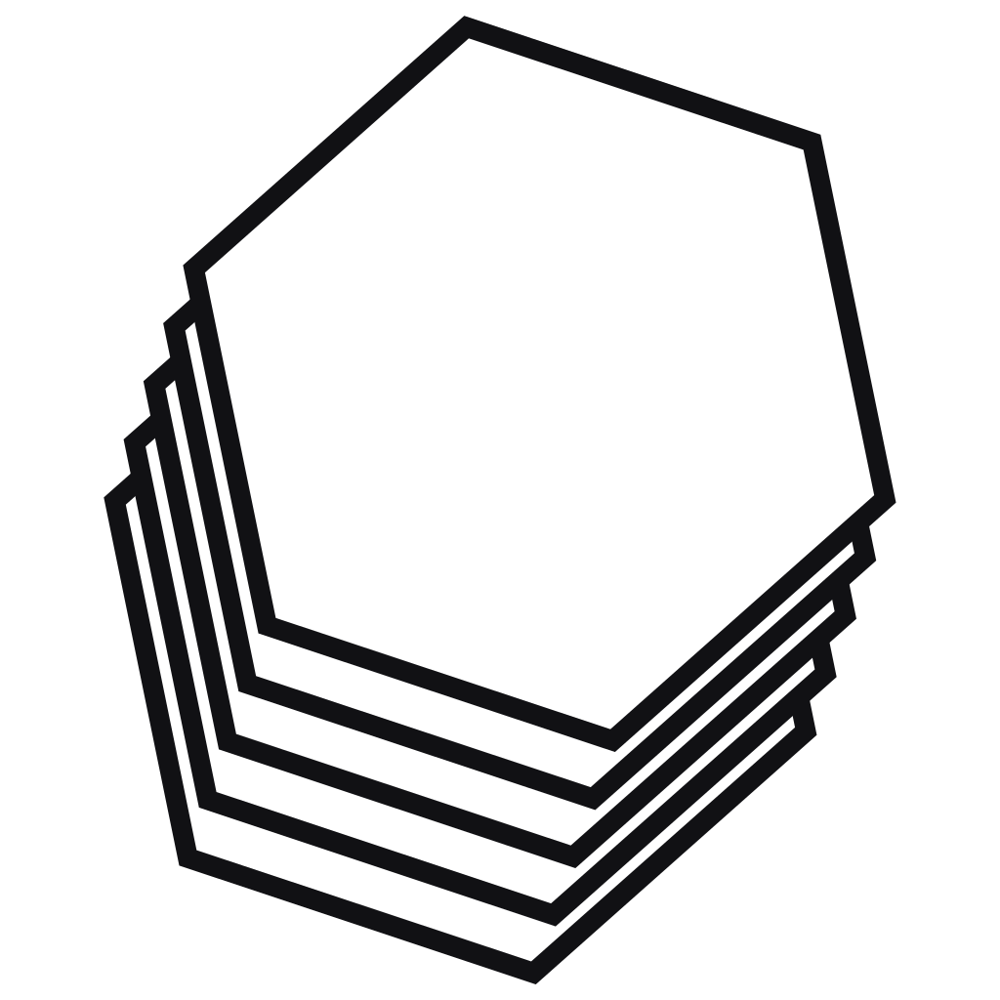

<div align="center">

<picture>
  <source media="(prefers-color-scheme: dark)" srcset=".github/brand-logo-dark.png">
  
</picture>

# SuperPhoto

**A photo retouching studio that runs in your browser and on your desktop.**
Layers, masks, selections, curves, levels, Bézier paths and non-destructive
previews — built with Astro 7 and Rust (Tauri 2) for Windows, macOS and Linux.

[](https://github.com/zigmoon/superphoto/actions)
[](https://github.com/zigmoon/superphoto/releases/latest)
[](LICENSE)
[](https://astro.build)
[](https://tauri.app)

**[Launch the web app](https://app.zigmoon.com/superphoto/) · [Features](#features) · [Web / FTP](#deploy-on-your-own-server-ftp) · [Build from source](#build-from-source)**

[](https://github.com/zigmoon/superphoto/releases)

</div>

---

## Download

**[→ Open the releases page](https://github.com/zigmoon/superphoto/releases)**
— the newest version is pinned at the top with every build (Windows, macOS,
Linux, plus the `SHA256SUMS` fingerprints), and the previous versions stay one
click below.

The direct links below already point at the newest release, so they keep working
release after release:

| Platform | Download | Notes |
| --- | --- | --- |
| **Windows 10/11 (x64)** | [`SuperPhoto-Windows-x64-setup.exe`](https://github.com/zigmoon/superphoto/releases/latest/download/SuperPhoto-Windows-x64-setup.exe) | NSIS installer, no admin rights required |
| **macOS (Apple Silicon + Intel)** | [`SuperPhoto-macOS-universal.dmg`](https://github.com/zigmoon/superphoto/releases/latest/download/SuperPhoto-macOS-universal.dmg) | Universal binary |
| **Linux (x86_64) — AppImage** | [`SuperPhoto-Linux-x86_64.AppImage`](https://github.com/zigmoon/superphoto/releases/latest/download/SuperPhoto-Linux-x86_64.AppImage) | `chmod +x` then run |
| **Linux (amd64) — Debian/Ubuntu** | [`SuperPhoto-Linux-amd64.deb`](https://github.com/zigmoon/superphoto/releases/latest/download/SuperPhoto-Linux-amd64.deb) | `sudo apt install ./SuperPhoto-Linux-amd64.deb` |

Nothing to install to try the editor: it also runs straight in the browser at
**<https://app.zigmoon.com/superphoto/>**. The static web build is **not**
published on GitHub — it is produced locally, in one command, for an FTP deploy
(see [Deploy on your own server](#deploy-on-your-own-server-ftp)).

<sub>Windows SmartScreen and macOS Gatekeeper show a warning on first launch
because the builds are not code-signed yet: **More info → Run anyway**, or
right-click → **Open** on macOS. The signing pipeline is already wired into the
workflow — see [docs/SIGNING.md](./docs/SIGNING.md) for the two certificates to
create and the six secrets to add; from then on both warnings disappear. All
releases are on the
[releases page](https://github.com/zigmoon/superphoto/releases).</sub>

### Verify your download

Every release ships a **`SHA256SUMS`** file listing the fingerprint of each
published file. Check it before running an installer:

```bash
# Linux
sha256sum -c SHA256SUMS --ignore-missing
```

```bash
# macOS — keep only the line of the file you downloaded
shasum -a 256 -c <(grep SuperPhoto-macOS-universal.dmg SHA256SUMS)
```

```powershell
# Windows PowerShell — compare with the matching line in SHA256SUMS
Get-FileHash .\SuperPhoto-Windows-x64-setup.exe -Algorithm SHA256
```

A mismatch means the file is incomplete or was tampered with: download it again
from the [releases page](https://github.com/zigmoon/superphoto/releases).

---

## Features

### Documents and tabs

- **Tabbed documents**, Photoshop-style, right above the preview: every image
  or project opens in its own tab, each with its own undo history, selection,
  zoom and scroll position.
- **Photoshop documents**: `.psd` opens with its layers, masks, opacity, blend
  modes and resolution — and exports back to a layered `.psd`.
- Close a tab with its **×**, a middle click, or `Ctrl/⌘ + W` on the last one.
- **Autosave**: every open tab is stored in the browser (IndexedDB) after each
  change — closing the tab no longer loses the work.
- A start dialog asks for **width, height and resolution** (or a preset), with
  **Create**, **Cancel** and **Open from computer**.

### Drag and drop, from anywhere

Drop files straight from your desktop onto the window — in the web app *and* in
the desktop builds:

`PNG` `JPEG` `WebP` `AVIF` `GIF` `TIFF` `BMP` `ICO` `SVG` `HEIC/HEIF` `JPEG XL`
`PNG/APNG` `TGA` `EXR` `HDR` — plus **videos** (`MP4`, `WebM`, `MOV`…), which
open on their first frame.

- **Several files at once** open in separate tabs.
- **`.sps`** project files reopen with all their layers.
- A translucent drop zone appears while you drag, and unsupported files are
  reported without breaking anything.

### Left column — Layers

Add, duplicate, delete and reorder. Visibility, opacity and 16 blend modes
(Normal, Multiply, Screen, Overlay, Darken, Lighten, Color Dodge/Burn, Hard and
Soft Light, Difference, Exclusion, Hue, Saturation, Color, Luminosity).

**Drag a row to reorder the stack** — a drop line shows where it will land, and
the whole move is a single undo step. Dragging a row that is part of a
multi-selection carries the whole group.

**Shift-click** (or ⌘/Ctrl-click) selects several layers at once.
Delete, duplicate, reorder and the opacity slider then apply to all of them.

**Lock** a layer with the padlock on the right of its row (or `Ctrl+/`). A locked
layer can still be selected, but it refuses painting, moving, resizing, filling,
adjustments, merging, deletion and reordering — its transform box is drawn dashed,
without handles. Every new document opens with its **Background** layer already
locked, exactly like Photoshop, so the backdrop cannot be painted over by
accident; unlock it if you really mean to.

**Layer masks** work like Photoshop's: add, paint, disable, re-enable, invert,
duplicate, apply to pixels or remove. When a selection is active, **Add a layer
mask** builds the mask *from the selection* — white inside, hidden outside — so
the mask does something the moment it appears instead of starting out as a blank
white sheet.

| Gesture on the mask thumbnail | Effect |
| --- | --- |
| Click | Paint the mask instead of the pixels |
| Click the **layer** thumbnail | Go back to painting the pixels |
| Shift-click | Disable / re-enable the mask without deleting it |

Painting with a light colour reveals, with a dark colour hides — the foreground
swatch decides, so `X` flips between the two. Masks follow the document through
image size, canvas size and crop, and they survive `.sps`, `.spp` and PSD
round-trips (PSD stores them in channel `-2`, so Photoshop opens them as real
layer masks).

**Right-click a layer row** for the Photoshop stack menu: rename (`F2`),
duplicate (`Ctrl+J`), delete, hide/show, mask from the selection, apply, invert,
duplicate or delete the mask, enable/disable, merge down (`Ctrl+E`), merge
visible, flatten, rasterize, lock, select all layers, keep only this one. On a
multi-selection the commands apply to the whole group.

**Right-click the canvas** for fill (`Alt+Backspace`), clear (`Delete`), layer via
copy, invert/deselect/select all, the five adjustments, image size, canvas size
and fit-to-window. Shortcut hints are localised, not hardcoded.

### Right column — Tools and adjustments

The **options of the active tool sit right under Zoom and Hand**, at the bottom of
the *Selection & drawing* grid, so choosing a tool never means scrolling past the
image and adjustment groups to find its settings.

| Tool | What it does |
| --- | --- |
| **Select** (`V`) | Pick a layer, draw its **transform box** (8 handles), drag the box to move, drag a handle to resize. |
| **Marquee** (`M`) | Rectangle, ellipse or lasso selection with a **feather** slider (0–120 px). |
| **Magic wand** (`W`) | Select by color proximity — tolerance, contiguous areas, sample the composite image, with the same feather. |
| **Crop** (`C`) | Free frame or 1:1, 4:3, 16:9, 3:2, 4:5; confirm with Enter. |
| **Shapes** (`U`) | Rectangle, ellipse, triangle, star, line — fill, stroke, width, radius. |
| **Pen** (`P`) | Bézier paths with a live rubber band: click for a corner, drag to bend, Shift snaps to 45°, Alt breaks the handles, double-click a point to smooth it, click the first point to close. Enter finishes and keeps the pen, Esc finishes and returns to Select. |
| **Text** (`T`) | Editable text blocks: content, font, size, weight, color, alignment. |
| **Pencil** (`N`) | Hard edge, no smoothing. Alt erases. |
| **Brush** (`B`) | Soft stamps: size 1–600 px, hardness, opacity, spacing, 8/24/56/120/280 presets. Alt erases. |
| **Eraser** (`E`) | Clears layer pixels (or hides mask areas). |
| **Clone stamp** (`S`) | Alt+click sets the source, then paint. Optional corrector blends colors. |
| **Patch** (`J`) | Draw the area to repair, drag it onto a clean area — with or without the corrector. |
| **Healing brush** (`K`) | Paint a blemish: four neighbouring discs vote, outliers are rejected, color is matched. |
| **Light spot** (`L`) | Circular light: diameter, intensity, softness; click to place or drag to size it. |
| **Eyedropper** (`I`) | Sample a color (Alt: secondary color). |
| **Gradient** (`G`) | Linear or radial, foreground → transparent, foreground → background, background → transparent. |
| **Zoom** (`Z`) | In/out, fit, 100/200/400 %, Ctrl/⌘ + wheel. |
| **Hand** (`H`) | Move the view; hold Space anywhere. |
| **Image size** | High-quality resampling of every layer (masks included). |
| **Canvas size** | Extend or crop with a 3×3 anchor. |
| **Tonality** | Exposure (EV), brightness, blacks. |
| **Contrast** | Global contrast. |
| **Color** | Saturation, hue, temperature, tint — one combined matrix, no colour drift. |
| **Levels** | Black point, white point, gamma, output black/white, over a live RGB histogram. |
| **Curves** | Smooth RGB / R / G / B curves, histogram behind the grid, S-curve and lift presets. |

Adjustments preview live on a downscaled copy (fast even on 30 Mpx images) and
are computed at full resolution when you apply them. The tone tools run through
a 256-entry lookup table, so levels and curves cost the same as a brightness
nudge — and the four curve channels are all applied, not only the one on screen.

### Curves that actually curve

The curve is a **monotone cubic spline** (Fritsch–Carlson / PCHIP), not a chain of
straight segments and not a Catmull-Rom: it passes through every point you place,
never overshoots into clipped blacks or blown highlights, and stays smooth at
every knot. What you see on the grid is the exact lookup table used on the
pixels, and the histogram of the active channel is drawn behind it so you can
place the points where the tones really are.

### Selections that actually feather

The **feather** radius is a real gradient mask, not a blurred border: it applies
to the brush, the eraser, fills, shapes, gradients, the light spot and every
adjustment, and it is shown in the canvas as a translucent band.

**Right-click in the canvas** to get the selection menu:

- **Fill the selection** (`Alt + Backspace`) with the primary color
- **Clear content** (`Del`)
- **Invert selection**
- **Deselect** (`Esc`)
- **Select all** (`Ctrl/⌘ + A`)

### Selecting and transforming an object

Selecting a layer (click it in the stack, or click its pixels with the Move tool)
draws a **bounding box with eight handles** around its content — the box is
measured on the real pixels, not on the canvas. Drag the box to move the layer,
drag a handle to resize it, `Shift` keeps the proportions, `Alt` scales from the
centre. Every gesture lands exactly where the pointer is, at any zoom, and each
one is a single undo step.

### Sliders that always look right

Every range input paints its filled portion from a single delegated listener plus
a `MutationObserver`, so a slider created later — plug-in parameters, layer
opacity, export quality — is styled the moment it appears and stays in sync when
its value changes in code
([`src/lib/ranges.ts`](./src/lib/ranges.ts)).

### Drawing a path with the pen

The pen behaves like a vector editor, not like a click-to-add-point tool:

- **Click** places a corner point; **drag** pulls symmetric handles out of it.
- **Shift** constrains the point to 45° from the previous one.
- **Alt** while dragging a handle breaks the pair, so the curve can kink.
- **Double-click** (or Alt-click) a point toggles it between smooth and corner.
- A **rubber band** previews the next segment, and the first point grows a ring
  when the pointer is close enough to close the path.
- Clicking the first point closes the path and **keeps the pen in hand**; the next
  click starts a new path.
- Clicking a **segment** of a closed path inserts a point there, splitting the
  Bézier with de Casteljau so the outline does not move.
- **Enter** commits and stays in the pen; **Esc** commits and switches to Select;
  **Backspace** removes the point under the cursor.

### Plug-ins

SuperPhoto ships with a plug-in system: a plug-in is a recorded entry in
[`src/lib/plugins.ts`](./src/lib/plugins.ts) — a list of effects, each one a pure
pixel function with its own sliders. Enable or disable a plug-in in
**Preferences → Plug-ins**; when at least one is active, its icon appears at the
right of the top bar, separated from Export (`Ctrl/⌘ + Alt + E`).

Clicking that icon opens a **drawer docked to the right of the workspace** — not
a floating dialog: it takes a column of its own, the canvas resizes to fit, and
the zoom / full-screen controls follow. A second click, the `×`, `Esc` or
**Cancel** closes it and restores the original pixels.

Each effect is an **accordion**: its name in one line, its sliders folded
underneath. Opening one closes the other, so the whole panel fits without
scrolling and nothing but the effect names is on screen. The description of an
effect is available as a tooltip on its title.

The preview is **live while you drag**: the slider renders a reduced copy at
once, then refines it automatically as soon as the gesture settles, so the
image follows the handle instead of lagging behind it. **Apply** recomputes at
full resolution with the same seeded randomness — what you see is exactly what
you get. Every application is one undo step. If the active layer has no pixels
yet, the footer says so instead of leaving you with a preview that seems broken.

**Effects 2026** (`v1.0.0`, included) is a film-lab panel in one dialog:

| Effect | What it does |
| --- | --- |
| **Chromatic glitch** | Splits the red and blue channels line by line, with jitter and tears |
| **Block shift** | Displaces horizontal bands — the classic datamosh smear |
| **Scanlines** | CRT lines plus a soft vignette |
| **Scratches** | Vertical bright or dark scratches from an old print |
| **Dust & specks** | Random specks and pinholes across the frame |
| **Film grain** | Grain sized in pixels, monochrome or chromatic |
| **VHS tape** | Chroma bleed, sparkle and an unstable tracking band |

### Save — the `.spp` package

**Save** (floppy icon, right of Open, `Ctrl/⌘ + Shift + S`) writes one `.spp`
file and asks whether to include **the current tab** or **all open tabs**:

| Choice | What goes in the file |
| --- | --- |
| Current tab | one document, its layers, masks, text, paths and colour mode |
| All tabs | every open document, plus which one was active |

A `.spp` is a **plain ZIP archive** — rename it to `.zip` and look inside:

```
manifest.json                 package index (one entry per document)
README.txt                    what the file contains, in clear text
preview.png                   preview of the active document
documents/doc-1.json          layers, text, paths, masks, colour mode
documents/doc-1/layer-1-*.png full-resolution layer pixels
documents/doc-1/mask-1.png    layer masks, when they exist
```

Images stay **binary PNG**, not base64: the package is smaller than the
equivalent `.sps` files and every layer stays openable on its own. Open it again
with **Open** (or drop it on the window): each document comes back as its own
tab, in the same order, with the same active tab. A package re-zipped by
Explorer, Finder or 7-Zip (deflate) is read just as well as one written here.

### Where an opened media goes

When a document is already open, opening an image asks where it should land:

| Choice | Effect |
| --- | --- |
| **In the current workspace** | replaces the document of the active tab (history reset) |
| **In a new tab** | keeps everything that is already open |

Dropping several files at once skips the question and gives each file its own
tab. `.sps` and `.spp` always open in new tabs.

### Colour modes

Documents carry a colour mode: **RGB** (default), **CMYK** or **B&W**. It is
chosen in the New dialog and can be changed at any time from
**Image → Colour mode** in the right column; the mode is shown in the title bar,
in the Layers panel and in the export summary.

SuperPhoto works in 8-bit RGB internally — that is what canvas gives without an
ICC engine. The mode therefore describes the **conversion** applied to the
pixels, the same way Photoshop's mode conversion works:

- **RGB → CMYK** simulates ink: total-area coverage limited to 300 %, dot gain on
  midtones, and a maximum ink density below 1, so saturated colours come out
  duller exactly as they would on paper.
- **→ B&W** applies Rec. 709 luminance to every layer.
- Going **back** to RGB does not restore what the narrower gamut clipped — the
  conversion is one undo step, and undo *does* restore the original pixels.

### Export

| Format | Keeps |
| --- | --- |
| **PNG** | Transparency, lossless |
| **JPEG** | Flattened on white, quality slider |
| **WebP** | Transparency, quality slider |
| **AVIF** | Transparency, quality slider — only offered when the browser can really encode it, never faked with a PNG |
| **TIFF** | Uncompressed baseline, resolution tag, RGB / RGBA / gray |
| **BMP** | 24-bit BGR, rows padded to 4 bytes, flattened on the document background |
| **EPS** | EPSF-3.0, flattened on white, vector-safe hex image data |
| **PSD** | **Layered** Photoshop file: one RLE layer per layer, masks, opacity, blend modes, DPI |
| **`.sps`** | **Everything**: layers, masks, opacity, blend modes, text and paths stay editable |
| **`.spp`** | The package format: a ZIP with a manifest, per-document JSON and PNG layers |

A `.sps` file is a single, self-contained JSON manifest with PNG-encoded
layers — reopen it in SuperPhoto, or drop it on the window like any image.
`.spp` and PSD round-trip through other software: the exported PSD opens in
Photoshop, Affinity Photo and GIMP with its layers intact.

### Importing Photoshop files

`Open` (or a drop) accepts **PSD** directly: 8-bit and 16-bit, RGB, CMYK and
grayscale, every layer with its name, opacity, blend mode, mask and the
document's DPI (`Image → Image size` shows the real resolution). Layer groups
are flattened into their parent, as SuperPhoto keeps a flat layer stack.
CMYK documents are converted to the RGB working space on import, using the same
ink simulation as the colour-mode switch.

### Importing TIFF

No browser decodes TIFF, so SuperPhoto reads it itself — that is the whole point
of the format for a retoucher, and it now opens:

- **compression**: none, LZW (with the horizontal predictor), Deflate/ZIP,
  PackBits, and JPEG-in-TIFF with its `JPEGTables` header re-spliced per strip;
- **layout**: strips *and* tiles, edge tiles read at their padded stride;
- **depth and spaces**: 8- and 16-bit, RGB, RGBA, grayscale, black-is-zero and
  CMYK (converted with the same ink arithmetic as the colour-mode switch);
- **resolution**: the file's DPI is applied to the document.

Verified against files written by libvips/Photoshop: LZW, ZIP, PackBits,
uncompressed, tiled, 16-bit, grayscale and RGBA all decode **pixel-exact**. The
one case that is refused instead of approximated is a **JPEG-compressed CMYK
TIFF**, whose colours depend on the decoder's Adobe convention: SuperPhoto says
so and asks for RGB or LZW rather than painting inverted colours.

Export-side, everything above round-trips: `.sps`, `.spp`, PSD, TIFF, BMP, PNG,
WebP, JPEG, EPS.


### Interface

- **Black and white only** — no accent color; the theme (light / dark / system)
  changes every surface, including the canvas chrome.
- **Three languages**: English (default), French and Japanese. The first launch
  follows your browser language; your choice is remembered in `localStorage`.
- Keyboard-first: `V M W C U P T N B E S J K L I G Z H` for tools, `[` `]` for
  the brush size, `Ctrl/⌘ + Z` / `Shift + Ctrl/⌘ + Z` for undo/redo, `F1` for the
  full shortcut list.
- Zoom and full screen sit at the bottom-right of the preview, exactly where
  SuperPrint puts them, and follow the side panels when they collapse.

### Tablets and phones

The layout has three shapes, chosen by the width of the window — nothing to
configure, no separate build:

| Width | Layout |
| --- | --- |
| **≥ 1181 px** | Layers on the left, canvas in the middle, tools on the right — the desktop layout |
| **≤ 1180 px** | Full-width canvas; layers and tools become **drawers** opened from the top bar, one at a time, dismissed by touching the canvas |
| **≤ 760 px** | Compact top bar (icon buttons, Export keeps its label), full-screen dialogs stacked in one column, larger touch targets |

The plug-in drawer follows the same rule and slides over the canvas instead of
squeezing it. Pinch-zoom, two-finger pan and touch painting work through the
same pointer pipeline as the mouse, so a stylus behaves as expected.

---

## Deploy on your own server (FTP)

The web build is a local artefact: it is **not** attached to any GitHub release,
and CI never publishes it. Build it yourself and send it over FTP.

```bash
npm install
npm run build:web:zip      # produces dist/ + superphoto-web.zip
```

Upload **the contents of `dist/`** (not the folder itself) anywhere on your
server — `/app/`, `/photo/`, a subdomain… Every link is relative, so no
recompilation is needed. The bundle includes:

```
index.html   .htaccess   favicon.svg   favicon-32.png
apple-touch-icon.png     site.webmanifest
robots.txt   sitemap.xml   llms.txt
assets/      brand/
```

`.htaccess` sets MIME types, compression and cache headers. Preview the exact
build locally with `npm run preview:web` (served at `http://localhost:8400/app/`).

SuperPhoto is live at **<https://app.zigmoon.com/superphoto/>**. Three files
handle discoverability, and all three carry that address:

- `robots.txt` — allows every crawler and points at the sitemap.
- `sitemap.xml` — the single page, with the Open Graph card as its image.
- `llms.txt` — a plain-text brief for language models: what the editor does,
  which formats it reads and writes, and the answers to the usual questions
  (“is it free”, “are my files uploaded”). The page also links it with
  `<link rel="alternate" type="text/plain">`, and embeds a
  `SoftwareApplication` JSON-LD block for rich results.

Publishing elsewhere? Set the canonical URL at build time — it feeds
`<link rel="canonical">`, `og:url`, `og:image` and the JSON-LD block:

```bash
PUBLIC_SITE_URL=https://example.com/photo/ npm run build:web:zip
```

The build prints the **SHA-256 of the zip**. After the FTP transfer, compare it
with the file on the server to be sure nothing was truncated:

```bash
sha256sum superphoto-web.zip        # Linux / macOS
Get-FileHash .\superphoto-web.zip -Algorithm SHA256   # Windows
```

---

## Build from source

### Requirements

- Node.js 20+ and npm
- Rust (stable) and the [Tauri 2 prerequisites](https://tauri.app/start/prerequisites/)
  for your platform (WebView2 on Windows, WebKitGTK on Linux, Xcode tools on macOS)

```bash
npm install

npm run dev            # web app on http://localhost:4321
npm run check          # astro check — types, templates, accessibility
npm run build          # static build into dist/
npm run brand          # regenerate every logo asset from the two SVGs
npm run brand:png      # rasterize the icons, favicon and social card
```

### Desktop

| Command | Mode | Result |
| --- | --- | --- |
| `npm run desktop:dev` | development | needs Astro running (`beforeDevCommand` starts it) |
| `npm run desktop:exe` / `desktop:build` | production | standalone binary, no network needed |
| `cargo build --features custom-protocol` | production | same, from `src-tauri/` |

> **`ERR_CONNECTION_REFUSED` on `localhost`?** A binary built with plain
> `cargo build` reads the *dev* URL (`http://localhost:4321`) because the
> `custom-protocol` feature is what embeds the frontend. Always build with
> `--features custom-protocol` (or use `npm run desktop:build`), then the app
> loads `http://tauri.localhost/`.

### Multi-platform builds (GitHub Actions)

`.github/workflows/build.yml` runs on every push to `main` and on tags:

| Job | Output |
| --- | --- |
| **Web (validation)** | builds the FTP folder to catch relative-link regressions; **no artefact kept** |
| **Windows x64** | `SuperPhoto_<version>_x64-setup.exe` |
| **Linux x64** | `.deb` + `.AppImage` |
| **macOS universal** | `SuperPhoto_<version>_universal.dmg` (Apple Silicon + Intel) |
| **Release GitHub** | on a `v*` tag: the desktop installers, plus stable names for the README links |

Releasing is just `git tag v0.2.3 && git push origin v0.2.3`.

Each install job is **unsigned by default** and becomes signed automatically
once the signing secrets are set — no workflow edit needed
([docs/SIGNING.md](./docs/SIGNING.md)):

| Platform | Activated by | Effect |
| --- | --- | --- |
| Windows | `AZURE_CLIENT_ID` + `AZURE_TS_*` variables | Authenticode signature (Azure Trusted Signing) |
| macOS | `APPLE_CERTIFICATE` + the five `APPLE_*` secrets | Developer ID signature + notarisation + stapled ticket |

Without them the build still produces installers, just unsigned: SmartScreen
shows *More info → Run anyway*, macOS needs right-click → **Open**.

---

## Architecture

```
src/
  components/   TopBar · DocTabs · LayersPanel · Stage · ToolRail
                StatusBar · dialogs (new, resize, export, preferences)
  layouts/      BaseLayout — meta, icons, theme and language bootstrap
  lib/
    editor.ts       controller: tools, tabs, history, autosave, menus
    document.ts     layers, composition, crop, resize
    painting.ts     brush engine: stamps, strokes, clone, heal, patch
    selection.ts    magic wand (flood fill → polygons)
    mask.ts         layer masks
    adjustments.ts  tonality, contrast, color, levels, curves
    colorspace.ts   RGB / CMYK / grayscale document modes
    zip.ts          minimal ZIP reader/writer (no dependency)
    package.ts      .spp package: manifest + document JSON + PNG layers
    project.ts      .sps read/write
    session.ts      IndexedDB autosave (all tabs)
    i18n.ts         EN / FR / JA dictionaries
    media.ts        image + video decoding (any format the platform supports)
    preferences.ts  theme, motion, quality, persistence
    ranges.ts       paints every slider's filled portion, automatically
  styles/app.css  design tokens, light and dark themes
src-tauri/        Rust backend: native file dialogs, image decoding, export
```

### Brand assets

One artwork — the visible layer of `super_photo_blanc.svg` — rasterized into
every size. No background plate anywhere: the file is fully transparent, so the
mark sits on the app, the favicon, the dock and the taskbar without a square
behind it.

| File | Usage |
| --- | --- |
| `src/assets/brand/app-icon.svg` | the mark inlined by `BrandMark.astro` (top bar, empty state, About, start dialog, drop zone) |
| `public/favicon.svg` | favicon, transparent, follows `prefers-color-scheme` |
| `public/favicon-32.png`, `public/apple-touch-icon.png` | PNG fallbacks and iOS icon |
| `public/brand/mark.svg` | the official two-tone mark: white plates, ink keylines |
| `public/brand/mark-white.svg` | same artwork with white keylines — for dark backgrounds |
| `public/brand/mark-light.svg`, `mark-dark.svg` | aliases of `mark.svg` for ``, e-mail and press use |
| `.github/brand-logo-light.png` | README header on a light page |
| `.github/brand-logo-dark.png` | README header on a dark page |
| `public/brand/app-icon.svg`, `icon-*.png` | PWA and store icons |
| `public/brand/og-image.png` | 1200 × 630 social card |

The README picks its logo with `<picture>` and `prefers-color-scheme`: GitHub's
dark theme shows the pure-white version (0 dark pixel, measured), the light
theme the ink-keyline one. A white logo on a white page would be invisible —
that is the only reason the pair exists. Both are rendered from the same
geometry, so the silhouette is identical.

---

## Keyboard shortcuts

Press `F1` (or `?`) anywhere to open the full, always up-to-date list.

| Shortcut | Action |
| --- | --- |
| `V M W C U P T N B E S J K L I G Z H` | tools (Select, Marquee, Wand, Crop, Shapes, Pen, Text, Pencil, Brush, Eraser, Clone stamp, Patch, Heal, Light spot, Eyedropper, Gradient, Zoom, Hand) |
| `[` / `]` | brush (or pencil) size |
| `Alt + click` | stamp source · temporary eraser · secondary color |
| `Ctrl/⌘ + Z` / `Ctrl/⌘ + Shift + Z` / `Ctrl/⌘ + Y` | undo / redo |
| `Ctrl/⌘ + N` / `Ctrl/⌘ + O` / `Ctrl/⌘ + S` | new / open / export |
| `Ctrl/⌘ + Shift + S` | save a `.spp` package (current tab or all tabs) |
| `Ctrl/⌘ + Shift + N` / `Ctrl/⌘ + J` | new layer / duplicate layer |
| `Ctrl/⌘ + E` | merge down |
| `Ctrl/⌘ + [` / `Ctrl/⌘ + ]` | move the layer down / up |
| `Alt + [` / `Alt + ]` | select the layer below / above |
| `Ctrl/⌘ + T` | free transform (box + handles) |
| `Ctrl/⌘ + Alt + E` | open the active plug-in (Effects 2026) |
| `Ctrl/⌘ + /` | lock / unlock the selected layers |
| `Shift + click` (layers) | add or remove a layer from the selection |
| `drag` (layers) | reorder the stack, group included |
| `← ↑ → ↓` (`Shift` ×10) | nudge the layer content by 1 px |
| `Ctrl/⌘ + A` / `Ctrl/⌘ + D` / `Ctrl/⌘ + Shift + I` | select all / deselect / invert |
| `Del` | clear the selection · **delete the layer** when nothing is selected · remove the hovered pen point |
| `Shift + Del` | clear the whole layer content, keeping the layer |
| `Alt + Del` / `Ctrl/⌘ + Del` | fill the selection with the primary / secondary color |
| `Ctrl/⌘ + 0` / `Ctrl/⌘ + 1` | fit to window / zoom 100 % |
| `Ctrl/⌘ + +` / `Ctrl/⌘ + -` | zoom in / out |
| `X` / `D` | swap / reset the primary and secondary colors |
| `Enter` | apply the crop · finish the pen path and keep the pen |
| `Esc` | cancel the adjustment, crop or selection · leave the pen for Select |
| `Shift` (pen) | snap the new point to 45° |
| `Alt` (pen) | break the handles while dragging |
| `double-click` (pen) | toggle a point between smooth and corner |
| `Space` | temporary hand |
| `F11` | full screen |
| `Space` | temporary hand |
| `F11` | full screen |

---

## License

[MIT](LICENSE) — SuperPhoto / SuperPrint.
